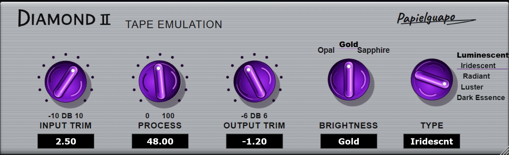

# DIAMOND II — Papielguapo Edition



A C++20 / JUCE 8 parallel tape-colour processor, with the supplied silver-metal / purple-knob skin, five saturation characters and three spectral profiles. Builds VST3 and Standalone for mono/stereo float processing. Resize by dragging the corner or right-click the panel to select 60–200%; dimensions are saved per instance with the plugin state. The reference artwork is embedded in the binary, and the knob faces rotate as the real parameters change. Numeric readouts remain editable. The base design is 1252×380; the original raster resolution determines sharpness when enlarged. Input trim is ±10 dB and Output trim is ±6 dB, matching the printed scales.

**Independent approximation, not a verified 1:1 clone of Phoenix II.** No proprietary source, reference binary, impulse captures or measurements were supplied. Character names and initial parameter values come from the design brief. There is no evidence here that Crane Song used these equations, memory model or filter settings. There is no affiliation with Crane Song or Dave Hill. Bit accuracy below concerns the dry unity path only. The initial brief's assertions about original hardware/DSP are not established engineering facts.

## Signal architecture

For input/output gains `gi`, `go` and Process `p` in [0,1]:

`dry = gi * x; excitation = Hpre(dry); delta = f(excitation, memory, envelope) - excitation; y = go * (dry + p * Hpost(DCblock(delta)))`.

The dry path never passes through the emphasis filters. At exactly 0 dB Input, 0% Process and 0 dB Output, the processor returns the original float directly, preserving its bit pattern (including signed zero) regardless of wet-path state. The wet model keeps running while dry. Input/output gain and Process transitions are smoothed over 15 ms; exact unity requests take effect immediately to preserve the null guarantee. Type and Brightness changes are discrete and can produce a transient; automate these between audio passages.

No oversampling, lookahead or added latency is used. Nonlinear aliasing is intentional and sample-rate dependent. No ADAA is claimed or implemented. Output is not limited: allow headroom, especially with positive output trim. This is not a loudness-matched emulation.

### Rational waveshaping

The exact rational formulas used are:

$$P_{3/2}(u)=\frac{u(27+u^2)}{27+9u^2},\qquad P_{5/4}(u)=\frac{u(945+105u^2+u^4)}{945+420u^2+15u^4}.$$

Both have unit slope at the origin. Inputs are clamped to ±3 and ±4 respectively to keep the rational tails bounded. Luminescent and Iridescent use `P54(k*u)/k`; Radiant and Dark Essence add a `P32(1.4*k*shaped)/(1.4*k)` second stage. Drives are 1.18, 1.5, 2.15, 0.92 and 2.8. Luster replaces its drive with `0.92 + 2.35 * min(env, 1) * (0.35 + 0.65*p)`.

### Chebyshev decomposition

$$T_2(t)=2t^2-1,\quad T_3(t)=4t^3-3t,\quad T_5(t)=16t^5-20t^3+5t.$$

With `t = clamp(u,-1,1)`, the additional shaping is:

`c2*(T2(t)+1) + 0.1*c3*(T3(t)+3*t) + 0.0005*(T5(t)-5*t)`.

This removes the constant and linear terms before DC blocking. `c2 = [0.018, 0.095, 0.025, 0.035, 0.055]`, `c3 = [0.065, 0.145, 0.11, 0.09, 0.18]`. These are musical design choices, not measured harmonic matches. The polynomial evaluation uses multiplies, with no per-sample transcendental calls in the production processing loop.

### One-state magnetic memory

$$m[n]=(1-\alpha)x[n]+\alpha m[n-1],\quad \alpha=e^{-1/(30\mu s\,f_s)},\quad u[n]=x[n]+0.035(m[n-1]-x[n]).$$

This is a one-state flux-inspired lag with previous-sample feedback, not a physical Jiles–Atherton solver. The envelope follows absolute peak level with 1.2 ms attack / 45 ms release. A 5 Hz DC blocker `d[n]=r[n]-r[n-1]+R*d[n-1]`, `R=exp(-2*pi*5/fs)`, operates in the residual branch for all modes. Dark Essence additionally compresses residual slew: `r = previous + (r-previous)/(1+0.35*abs(r-previous))`.

### Brightness

The bilinear high-shelf implementation uses `K=tan(pi*fc/fs)`, `V=10^(dB/20)` and `N=1/(1+sqrt(2)*K+K*K)`. Its coefficients are `(b0,b1,b2)=N*(V+sqrt(2V)*K+K*K, 2*(K*K-V), V-sqrt(2V)*K+K*K)` and `(a1,a2)=N*(2*(K*K-1),1-sqrt(2)*K+K*K)`.

Opal applies a −4 dB post shelf at 2.4 kHz. Gold uses flat pre-emphasis and a +0.15 dB post shelf at 3.2 kHz. Sapphire applies +3.5 dB at 2.8 kHz before shaping and −1.75 dB at 3.2 kHz afterward. Coefficients are regenerated at the actual sample rate or brightness change. Filters affect only the residual path.

## Build

Requires Git, CMake ≥3.24, a C++20 compiler, internet access on first configure, and JUCE platform dependencies. JUCE 8.0.12 is pinned to commit `29396c22c93392d6738e021b83196283d6e4d850` and fetched by CMake. A local checkout can be selected with `-DDIAMOND_LOCAL_JUCE=ON -DJUCE_SOURCE_DIR=/absolute/path/to/JUCE`.

Windows, with Visual Studio C++ tools and Windows SDK installed:

```powershell
cmake -S . -B build -A x64
cmake --build build --config Release --parallel 2
ctest --test-dir build -C Release --output-on-failure
& ./build/GeneratePluginScreenshot_artefacts/Release/GeneratePluginScreenshot.exe "$PWD/assets/screenshot.png"
```

macOS, with Xcode command-line tools:

```sh
cmake -S . -B build -G Xcode -DCMAKE_OSX_ARCHITECTURES='arm64;x86_64'
cmake --build build --config Release --parallel 2
ctest --test-dir build -C Release --output-on-failure
./build/GeneratePluginScreenshot_artefacts/Release/GeneratePluginScreenshot "$PWD/assets/screenshot.png"
```

Linux (Debian/Ubuntu example), with an active graphical session for GUI tests:

```sh
sudo apt install build-essential cmake git libasound2-dev libjack-jackd2-dev libx11-dev libxext-dev libxinerama-dev libxrandr-dev libxcursor-dev libfreetype6-dev libfontconfig1-dev libgl1-mesa-dev
cmake -S . -B build -DCMAKE_BUILD_TYPE=Release
cmake --build build --parallel 2
ctest --test-dir build --output-on-failure
./build/GeneratePluginScreenshot_artefacts/Release/GeneratePluginScreenshot "$PWD/assets/screenshot.png"
```

Find plugins under `build/DiamondII_artefacts/Release/VST3/` and the executable under `Standalone/`. Copy the complete `.vst3` bundle to your DAW's VST3 folder and rescan. Windows user location: `%LOCALAPPDATA%/Programs/Common/VST3`; system location: `C:/Program Files/Common Files/VST3`. Standalone audio device settings are available through JUCE's application controls. Binaries are unsigned. macOS and Linux build instructions are provided but have not been executed in this Windows environment.

## Verification

`DspVerificationTest` tests the actual AudioProcessor, not a separate mock. The finite randomized null test covers all 5 types × 3 brightness settings × 5 sample rates (44.1, 48, 88.2, 96 and 192 kHz), including positive and negative zero, using bitwise IEEE-754 comparisons. Additional tests stress maximum trims (+10 dB input / +6 dB output) and full processing, channel isolation, reset silence, active nonlinearity, rational unit slopes, UI resize bounds, state round-trip, and exact unity after an active wet state. Release checks throw on failure; they do not depend on disabled `assert()` macros. Passing a finite test suite does not prove every possible input or host is supported.

`GeneratePluginScreenshot` initializes `ScopedJuceInitialiser_GUI`, instantiates the actual processor/editor, sets +2.50 dB / 48% / −1.20 dB / Gold / Iridescent, and captures a 980×300 logical component at 2×. The reference skin fits proportionally with narrow black letterboxing because its aspect ratio differs slightly from 1960×600. The tool fails unless the PNG is 1960×600 and exceeds 50 KiB. Additional PNGs record each resize preset. It is an offscreen render of the real component, not a photograph of a DAW window. Host resize negotiation and interaction in third-party DAWs have not been tested.

See [assets/verification.txt](assets/verification.txt) for actual local build/test results. The exact dry null is `0.0f` difference / `−inf dBFS`; it does not establish bit-identical wet processing with another product.

## License

Original project sources are MIT licensed (see LICENSE). The supplied skin in `assets/skin-reference.png` is user-provided artwork and is excluded from the source-code license grant. JUCE is a separate dependency with its own AGPLv3/commercial licensing requirements: review [JUCE's licensing](https://juce.com/legal/juce-8-licence/) before distributing proprietary binaries. No third-party plugin DSP code is included.
